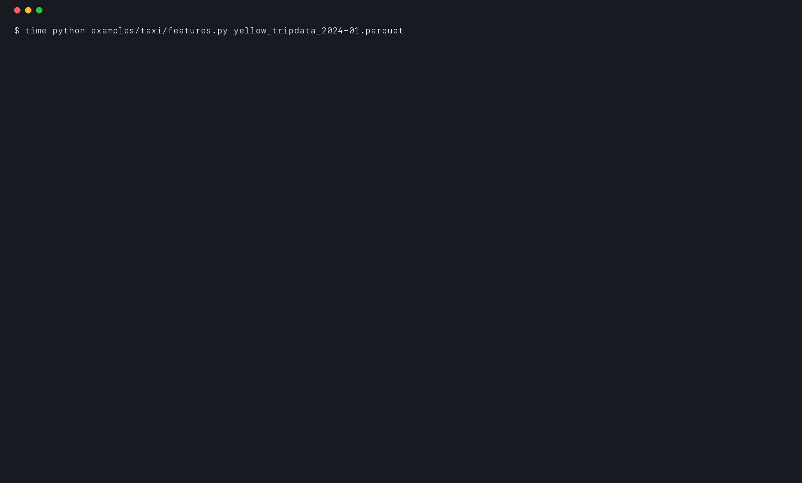

# pandas-doctor

pandas-doctor finds the slow pandas lines in your code, rewrites them, and checks on your own data that the result is exactly the same. Then it tells you how much faster the rewrite was, measured, not guessed.



That's a real run: [`examples/hero/features.py`](examples/hero/features.py), 1 million synthetic taxi trips with the kind of loops a lot of notebooks have. The script took **29.3 s**. pandas-doctor checked 5 rewrites on the script's own data, all identical and faster. After `--fix` the whole script runs in **0.96 s** and prints exactly the same output. Full report in [`docs/hero-run-full.txt`](docs/hero-run-full.txt).

## Try it

```bash
pip install pandas-doctor
pandas-doctor run your_script.py
```

`run` executes your script normally. Wherever it spots a slow pattern, it copies that code's inputs, lets your code run as usual, then runs the rewrite on the copies and compares the outputs. `--diff` shows the verified rewrites as a patch, and `--fix` writes them into the file.

In a notebook:

```python
%load_ext pandas_doctor
```
```python
%%doctor
for i, row in df.iterrows():
    df.at[i, "total"] = row["price"] * row["qty"]
```

`%%doctor --rewrite` drops the verified version into a new cell below.

## What "identical" means

Two results count as identical only when they have:
- the same type (`numpy.float64` is not `float`)
- the same dtype, index and columns, labels and names included
- missing values in the same places
- exactly equal values

That's stricter than it sounds, and it catches real differences:

- `iterrows` hands you each row as a Series, so an int column turns into floats when the frame also has float columns. The obvious rewrite keeps the ints, and the dtype changes.
- In an all-numeric frame, collecting `row["x"] * 2` into a list gives numpy floats; the same thing via `.tolist()` gives Python floats.
- Summing in a different order changes the last few bits of a float. pandas-doctor reports that as *equal within tolerance* and shows the largest difference, rather than calling it identical.

When the plain rewrite isn't identical, pandas-doctor tries a few more faithful versions: the row dtype iterrows used, numpy scalars, the same summation order. It keeps the first one that matches exactly. If none does, it tells you why and changes nothing.

A rewrite that is identical but not faster isn't recommended either. That happens: on python-backed strings, `.str.lower()` can be slower than `.apply(lambda x: x.lower())`.

"Verified" always means *on this data*. It's a strong check, not a proof for every possible input.

## Why not just ask an AI?

An assistant can suggest the same rewrites, but it can't tell you whether they give the same result on your data, and as the examples above show, they often don't. pandas-doctor runs both versions and compares them. If you do use an assistant, it can call pandas-doctor to check its own edits (see [AI assistants](#ai-assistants)).

## Three commands

| Command | What it does | Runs your code? |
|---|---|---|
| `pandas-doctor check PATH` | Finds slow patterns in `.py` files and notebooks, prints suggested rewrites. Fast, for CI and pre-commit. | No |
| `pandas-doctor run script.py` | Runs the script, checks each rewrite on its data, times both versions, and can apply the verified ones. | Yes, that's the point |
| `pandas-doctor verify` | Bring your own rewrite: give it the original, the candidate and setup code that builds the inputs. | Only those snippets |

```bash
pandas-doctor verify --setup setup.py --original slow.py --candidate fast.py
```

## What it looks for

| Rule | Slow pattern | Rewrite | Measured, 100k rows | Result |
|---|---|---|---|---|
| PDD001 | `for i, row in df.iterrows(): ...` | column expression, `.sum()`, `.extend(...)` | 1.13 s → 79 µs (14,239x) | identical |
| PDD002 | `df.apply(f, axis=1)` with column maths | column expression or `np.where` | 192 ms → 92 µs (2,091x) | identical |
| PDD003 | `X = pd.concat([X, part])` in a loop | collect parts, one `pd.concat` (unsafe fix) | 65.5 ms → 2.3 ms (29x) | identical |
| PDD004 | `s.apply(lambda x: ...)`, `.map(lambda ...)` | `.str` / `.dt` / arithmetic | 27.8 ms → 403 µs (69x) | identical |
| PDD005 | `groupby(...).apply(lambda g: g[c].count())` | `groupby(...)[c].count()` | 4.2 ms → 479 µs (8.8x) | identical |
| PDD006 | per-column `astype` loop (`run` only) | one `astype` call | 102 ms → 111 ms (1.1x slower) | identical |
| PDD007 | `df.at[i, c] = ...` in a loop over the index | whole-column assignment | 844 ms → 64 µs (13,283x) | identical |
| PDD008 | text columns with few distinct values (`run` only) | `category` | memory: 52.8 MB → 1.0 MB on 1M rows | suggestion only |

Measured with [`benchmarks/`](benchmarks/) on an Apple M4 Pro, Python 3.13.5, pandas 3.1.0, numpy 2.5.4 (full results for pandas 2.2.3 and with pyarrow are in [`benchmarks/results/`](benchmarks/results/)). Each row is one example of the pattern; your speedup depends on your data and what the loop does.

Two results worth knowing:

- **String methods depend on the string backend.** `.apply(lambda x: x.strip().lower())` → `.str.strip().str.lower()` was 5.6 ms → 8.7 ms (1.5x slower) without pyarrow, but 8.0 ms → 1.9 ms (4.2x) with pyarrow installed. pandas-doctor measures before recommending it.
- **groupby sums aren't bit-identical.** `groupby.apply(lambda g: g[c].sum())` → `groupby[c].sum()` is 5.7 ms → 613 µs (9.3x), but pandas' built-in sum uses compensated summation, so the result matches only to within a relative 2.2e-16. pandas-doctor reports that and only applies it with `--rtol`.

PDD006 and PDD008 need the data, so only `run` reports them. PDD006 shows up only when one `astype` call really is faster; on today's pandas releases it usually isn't.

`check --fix` never changes behaviour on its own. The concat rewrite (PDD003) is identical only when every part has the same columns and dtypes; the property tests found frames where it isn't. So it's an unsafe fix that needs `--unsafe-fixes`, and `run` checks it on your data.

Before release, `check` was run over 8,419 files from 13 public repos (pandas, statsmodels, Kaggle courses, popular notebook collections) to hunt for false positives. The results and fixes are in [`docs/corpus.md`](docs/corpus.md). Slow lines it found in well-known teaching notebooks, re-measured, are in the [speedup gallery](docs/gallery.md).

## In CI

pre-commit:

```yaml
- repo: https://github.com/furqan-khan07/pandas-doctor
  rev: v0.1.0
  hooks:
    - id: pandas-doctor
```

GitHub Action. It annotates the diff and keeps one summary comment on the PR:

```yaml
- uses: furqan-khan07/pandas-doctor@v0.1.0
  with:
    paths: src notebooks
```

The comment needs `permissions: pull-requests: write`. `check --format json` works with anything else.

## AI assistants

`pandas-doctor mcp` serves three tools over MCP: `check_code`, `verify_rewrite` and `list_rules`. Install it with `pip install "pandas-doctor[mcp]"`. For Claude Code there's a plugin with a skill that tells the assistant to verify before claiming a speedup:

```
/plugin marketplace add furqan-khan07/pandas-doctor
/plugin install pandas-doctor@pandas-doctor
```

## Limits

- `run` executes your script once, as `python script.py` would. Flagged blocks that are plain computation (no files, network or randomness) are re-run on copies to get a stable median. Slower blocks are timed once, during your run, and the report says so.
- Each flagged spot is checked on its first call. Inputs over 2 GB aren't copied, so they aren't checked.
- Rewrites exist only for the shapes in the table. Anything else gets a note, not a guess.
- No network calls, no telemetry.
- Supports Python 3.11+ and pandas 2.2+, tested on pandas 2.2 through 3.1.

## Contributing

Found a false positive, or a slow pattern it should know? Open an issue with a small snippet. Patterns that come with a before/after test and a benchmark are the easiest to add.

---

Made by [Furqan Khan](https://github.com/furqan-khan07), a pandas contributor. MIT licensed.
